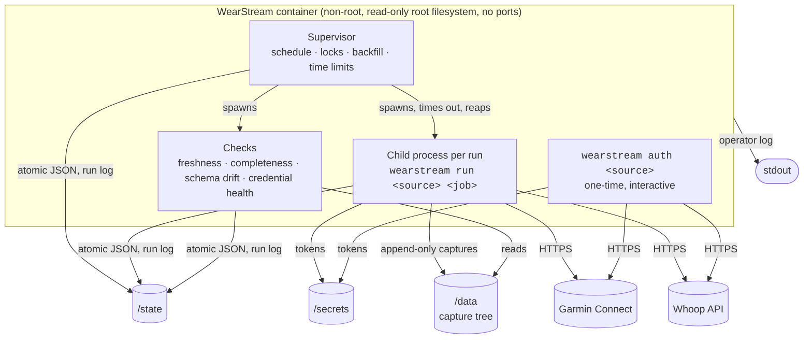

# High-Level Design: WearStream

## Problem

Wearable vendors hold your health and training data, and their apps show it on their terms.
The vendor APIs that expose it restate history (Whoop rescores sleep and recovery), sync late
(a Garmin device can upload days after the fact), rotate credentials on every refresh and
change without notice. Anyone who wants a complete, durable copy of their own data has two
options today: export by hand, which is partial and never stays current, or run a general
orchestrator such as Dagster or Airflow, which means operating a scheduler, a metadata
database and a web UI just to call two APIs on a timer.

## Approach

WearStream is one self-hosted container that keeps a complete local copy of one person's raw
Whoop and Garmin Connect data, current on its own schedule, with no other service to run.

### Raw capture, never parsed

WearStream writes every successful source response to disk as it was returned, with a
sidecar describing when, how and from where it was fetched. It never parses, merges or
deletes records. The capture tree under `/data` is the person's durable record of what each
vendor said and when. In a medallion-style data lake this tree is the bronze layer; typed
tables are built from it later, by WearStream's future export or by any other tool.

### Re-capture trailing windows

Sources restate history, so each source re-captures a trailing window of recent days on
every scheduled tick, not each day once. A payload byte-identical to the newest capture
already on disk is skipped, so a re-capture costs an API call but no storage unless the
source returned something new. Downstream readers resolve multiple captures of the same day
by taking the latest.

### A supervisor and one child process per run

A long-running supervisor process owns the schedule, the per-source locks and the state
files. Every unit of work (one source, one job, one day) runs as a child process with a
hard time limit. The supervisor kills a run that exceeds its limit and releases its lock, so
a hung vendor call can never block a source indefinitely.

### Operated through logs, configured through the environment

The container has no UI, no listening port and no shell. Operators configure it with
environment variables and secret files, and learn what it is doing from its log, which is
written for a technically capable person rather than for a machine. Every problem that
needs a person says what to do about it. The only interactive step is a one-time
credential bootstrap per source.

## Target Users

A technically capable individual who self-hosts services with Docker (whether through
Compose, Ansible or plain `docker run`) and wants to own their wearable data. They can edit
environment variables, mount volumes and read logs. They are not expected to know data
engineering vocabulary, run an orchestrator, or watch a dashboard. One instance serves one
person, who may use Whoop, Garmin or both.

## Goals

- The capture tree holds the most complete record each source will give, including data
  the source syncs late or corrects after the fact.
- After the one-time credential bootstrap, WearStream runs unattended for months: no
  scheduled task needs a person.
- A person reading only the log can tell whether WearStream is healthy, what it captured,
  and what to do when something needs them.
- First start against an empty capture tree fills history back to an operator-configured start date
  without the operator scheduling anything; restarts resume where they stopped.
- The capture tree layout is byte-compatible with an existing grecohome-dagster bronze tree,
  so an existing tree can be mounted as `/data` and WearStream continues it.

## Non-Goals

- **Parsed or typed tables in v1.** A Parquet export is a later feature. v1 must not block
  it: the capture tree stays self-describing and an export only ever reads it.
- **Any user interface, HTTP API or listening port.**
- **Multiple people per instance**, or any multi-tenant scaling.
- **Remote or object storage** (S3 and similar) in v1. Captures go to the local filesystem.
- **Metrics endpoints or push alerting** (Prometheus, webhooks) in v1. Logs are the
  operator interface.
- **Sources beyond Whoop and Garmin Connect** in v1. The core is source-agnostic so others
  can follow.
- **Garmin's official Personal API in v1.** Garmin capture goes through the `garminconnect`
  library and Garmin's consumer sign-in (see Key Design Decisions).
- **A transactional database** of any kind, for captures or for WearStream's own state.
- **Distributed execution** (task queues, brokers, worker pools across hosts).

## Tenets

Ordered. The higher tenet wins a conflict.

- **Protect the credential over fresh data.** When keeping a vendor grant alive conflicts
  with capturing promptly, protect the grant: skip the capture, never retry a credential
  exchange that might have consumed a single-use token.
- **Completeness over economy.** When more complete data and fewer API calls or less
  storage pull in opposite directions, keep the more complete data.
- **Small attack surface over convenience.** When a feature would make setup or operation
  easier by adding a listening port, a shell, an outbound destination or a credential in an
  environment variable, prefer the less convenient design.
- **Compatibility with existing captures over a cleaner layout.** When a fresh layout or
  sidecar format would be tidier than the one existing capture trees use, keep the existing
  one.
- **Shared core, source-specific overrides.** Put behavior in the core and have each source
  use it. Add source-specific logic only where that source's data demands it, and write down
  why in the source's design doc.

## System Design

### Processes and commands

One image, one entry point, `wearstream`, with these commands:

| Command | Who runs it | What it does |
|---|---|---|
| `wearstream daemon` | Container entry point | Runs the supervisor until stopped |
| `wearstream run <source> <job> [--day D]` | The supervisor; an operator for a one-off | Executes one unit of work and exits |
| `wearstream auth <source>` | The operator, once per source | Interactive credential bootstrap; writes to `/secrets` |
| `wearstream accept-schema <source> <collection>` | The operator, after a schema-drift error | Accepts a vendor's payload change as the new expected shape |
| `wearstream config` | The operator, before starting or after a change | Prints the effective configuration and every problem with it |
| `wearstream version` | Anyone | Prints the version |
| `wearstream status` | The operator, any time | Prints a summary from `/state`: last runs, backfill progress, failing checks |
| `wearstream healthcheck` | The container health check | Exits `1` when the supervisor's heartbeat in `/state` is stale, capture is paused because `/data` or `/state` is unusable, or the configuration is invalid |

The operator reaches `auth` and `status` by running them in the existing container
(`docker exec -it wearstream wearstream auth whoop`) or in a one-off container with the same
mounts (`docker run --rm -it …`). Both work from Compose, Ansible or plain Docker, and
neither needs a shell in the image.

### Mounts

| Mount | Holds | Access |
|---|---|---|
| `/data` | The capture tree: `<source>/<collection>/dt=YYYY-MM-DD/` payloads and sidecars | Read-write, append-only by design |
| `/state` | WearStream's own state: run log, schedule and backfill progress, check baselines and results, supervisor heartbeat | Read-write, on a local filesystem (WearStream relies on file locks) |
| `/secrets` | Vendor tokens (Whoop token file, Garmin token store), plus the static credentials supplied as secret files | Read-write for tokens, mode 0700 |

Tokens live apart from `/state` so that state can be backed up, shared in a bug report or
inspected without exposing a credential.

## Components

The design is split into these components, each with its own design doc under
`docs/intent/`:

| Component | Role |
|---|---|
| Capture | The capture-tree contract: layout, sidecars, atomic append-only writes, skip-identical, secret screening |
| Supervisor | Scheduling, per-source locks, child-process execution and time limits, catch-up on start, backfill, the state directory |
| Checks | Data-health and credential-health checks over the capture tree and `/secrets`, reported to the log |
| Operator interface | Configuration (environment and secret files), the commands above, and the operator log |
| Whoop | Whoop OAuth token lifecycle and capture of its collections |
| Garmin | Garmin Connect sign-in (through `garminconnect`) and capture of its catalog |
| Delivery | The container image, its hardening, CI and the reference deployments |

Sources depend on the core components, never the reverse, so a change to a core contract
cascades to every source that relies on it.

## Key Design Decisions

- **A supervisor with one child process per run.** The supervisor owns time; children own
  vendor calls. A child that exceeds its time limit is killed along with its process group,
  and its lock is released. This is chosen over running work in-process because the Garmin
  client is synchronous and a thread blocked in a socket read cannot be cancelled, so only a
  process boundary gives a hard limit; it also gives every run a clean client and confines a
  crash to one run. It is chosen over leaving scheduling to host cron or systemd timers
  because the trailing windows, off-minute ticks, overlap rules and backfill sequencing would
  then be every operator's job to reproduce. A task queue (Celery, Redis, RQ) is rejected:
  it solves distribution across machines and adds services to deploy and secure, for a
  workload of a handful of runs an hour on one host.
- **The schedule is part of the product.** Each source declares its jobs, cadences and
  trailing windows with defaults proven in production, and the operator can override them
  through configuration within guardrails. No tick lands on minute 0, where host cron jobs
  and other services crowd. A tick that arrives while the same job still has scheduled work
  queued or running is skipped, not queued. On start, the supervisor runs any job whose last
  completed tick is older than its cadence.
- **Backfill fills missing days and yields to the schedule.** On first start, after any
  restart and daily, the supervisor works back from the start of the trailing window to the
  backfill start, capturing only days that have no capture yet or whose last run did not
  succeed, one day at a time, under the same source lock as scheduled ticks and only when the
  source has nothing else queued. The backfill start is the operator's configured date, or by
  default the earliest day already in `/data`, so adopting an existing tree fills the gap since
  its last capture without re-pulling its history. Progress is persisted, so a restart
  resumes. Re-capturing days that already have data is the trailing window's job, not
  backfill's.
- **Partitions are UTC fetch slices.** A capture's `dt=` folder is the UTC day of the fetch
  window `[day 00:00Z, next day 00:00Z)`, never a local or semantic day. Local-day meaning
  (which night a sleep belongs to) is applied by readers over the payload's own timestamps.
  Garmin is the one exception: its daily endpoints take a calendar date and answer for the
  account's **local** day, so a Garmin `dt=` is the calendar date requested, which is the
  account's local day. WearStream sends dates, never time ranges, to those endpoints, so the
  folder is still exactly what was asked for; readers apply the same rule of trusting the
  payload's own timestamps.
- **The capture tree is the contract.** Its layout and sidecar format match grecohome-dagster
  bronze byte for byte, and nothing in WearStream reads its own captures back to decide what
  to fetch, except backfill's "does this day have a capture" and "what is the earliest day
  with a capture", and skip-identical's "is this byte-identical to the newest capture".
  Checks read the tree to report on it, never to decide what to fetch. State that WearStream
  needs lives in `/state`, so
  deleting `/state` loses progress and baselines but never data.
- **State is plain files.** `/state` holds JSON documents written atomically (write a
  temporary file, fsync, rename) and an append-only JSON Lines run log. No SQLite and no
  database: the state is small, a person can read it with `cat` and `jq`, and it follows the
  same durability discipline as the capture tree.
- **Credentials are bootstrapped once, interactively, and never through a listener.** Whoop
  needs a browser authorization; Garmin's consumer sign-in may need an MFA code. `wearstream
  auth` prints the Whoop authorization URL and takes the redirected URL pasted back, or
  prompts for the Garmin MFA code, then writes the token to `/secrets`. Until a source has a
  token, the supervisor keeps that source waiting and logs what to run. A built-in callback
  server is rejected because it opens a port, and on a remote host it needs a tunnel anyway.
- **Whoop refresh tokens are single-use, so a refresh is never retried with the same
  token.** Whoop rotates the refresh token on every refresh and treats reuse as theft,
  revoking the grant. A refresh that fails after reaching Whoop is not retried; only a
  connection that never reached Whoop is. Token writes are atomic and serialized by a
  cross-process lock shared by runs and the `auth` command.
- **Garmin goes through `garminconnect` and the consumer sign-in.** It is the only path that
  reaches the full catalog, including training status, race predictions and per-activity
  splits. Garmin's official Personal API is read-only, covers a fraction of the catalog and
  is limited to personal use; it is the expected future path if its coverage grows, and is
  out of scope for v1. One Garmin sign-in serves a whole run.
- **The operator log is the interface.** Logs go to stdout, human-readable by default and
  JSON Lines with `WEARSTREAM_LOG_FORMAT=json`. Every line carries a stable event name. Anything that
  needs a person is logged at `ERROR` with a plain-language `action` field saying what to do.
  Logs never contain a token, client secret or password, including inside a traceback:
  tracebacks are rendered without local variables or exception messages. The one exception is a
  troubleshooting switch that lets the Garmin library log, which warns on every start while it
  is on.
- **Python.** WearStream is Python because `garminconnect`, which signs in to Garmin through
  browser TLS impersonation, has no maintained equivalent elsewhere, and because the Whoop
  token lifecycle rules above exist as tested Python. The workload is I/O-bound and runs a
  few times an hour, so runtime speed does not matter. The capture tree, configuration and
  commands are the stable contract, so a future reimplementation can replace the internals
  behind them.
- **A hardened, single-architecture image.** The image is distroless (no shell), runs as a
  non-root user, expects a read-only root filesystem, needs no Linux capabilities, publishes
  no port and is built for `linux/amd64`. CI uses the organization's shared workflows, which
  build, sign and attest the image and scan the locked dependencies.

## Success Metrics

- No vendor grant is lost to WearStream's own behavior (a refresh retry, two writers on one
  token, a refresh at a congested minute). A grant loss whose cause is WearStream is a defect.
- Every scheduled job runs within one cadence of its due time while the container is up, and
  a run that hangs is killed within its time limit.
- A first start against an empty `/data` reaches the configured start date without operator
  action, and a restart mid-backfill resumes without re-fetching completed days.
- Mounting an existing grecohome-dagster bronze tree as `/data` produces new captures
  indistinguishable in layout and sidecar format from the existing ones.
- An operator shown only the log of a failing instance can identify the problem and the
  action to take.

Falsification: a person needs to run a command on a schedule, read code, or inspect `/state`
by hand to keep captures flowing or to learn that they have stopped.

## References

- Whoop developer platform: OAuth 2.0 authorization code flow with rotating refresh tokens.
- `garminconnect` (`cyberjunky/python-garminconnect`): unofficial Garmin Connect client.
- Garmin Connect Personal API: the official, read-only personal-use API, tracked for the future.
- grecohome-dagster: the Dagster pipelines WearStream's capture, Whoop and Garmin behavior
  is drawn from, and whose bronze layout WearStream continues.
- `chainringlabs/ci`: shared reusable GitHub Actions workflows.
